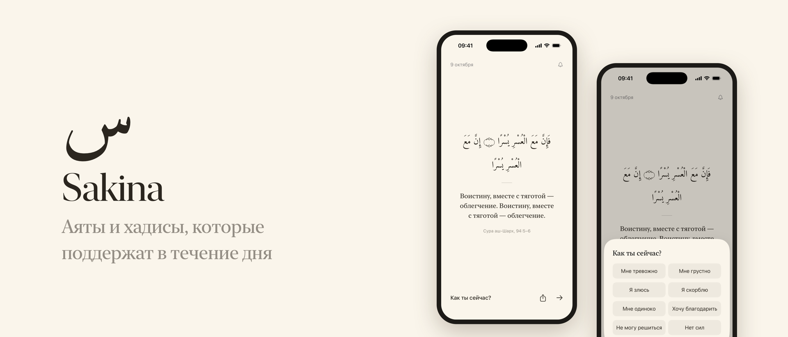
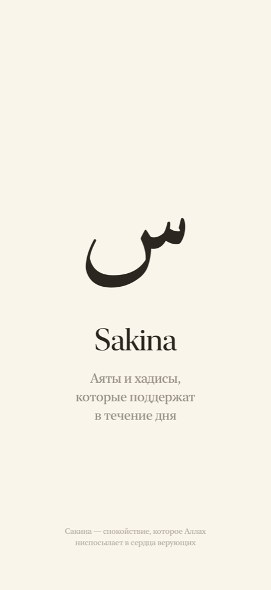
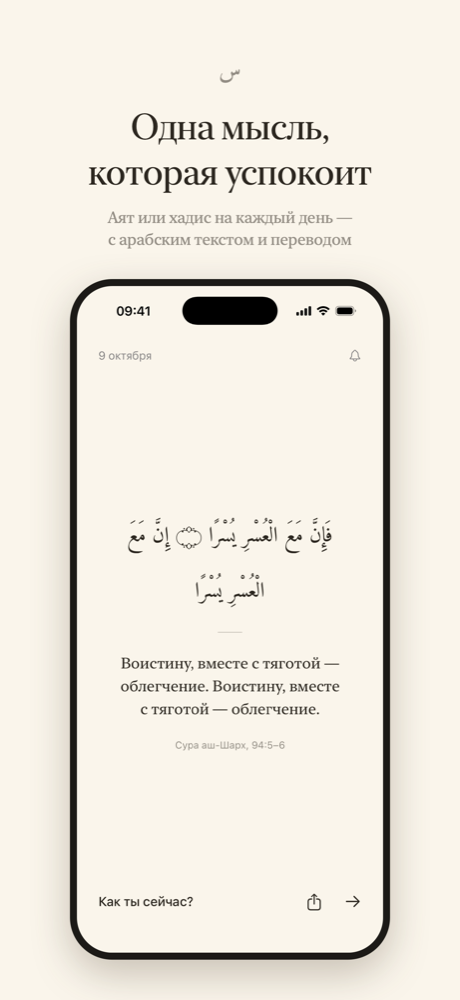
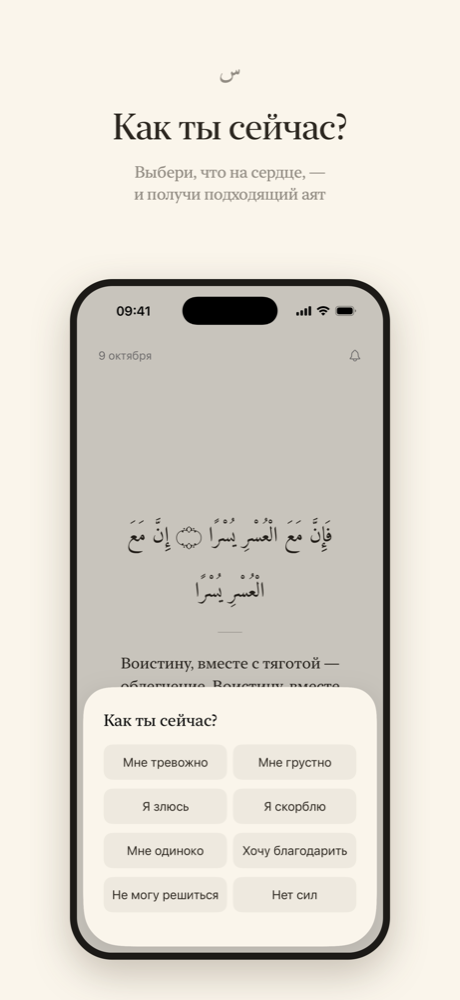
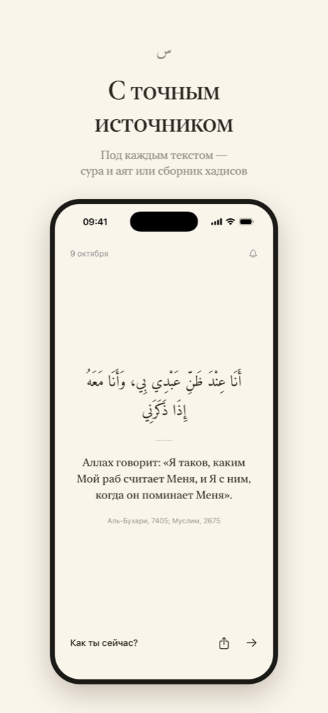
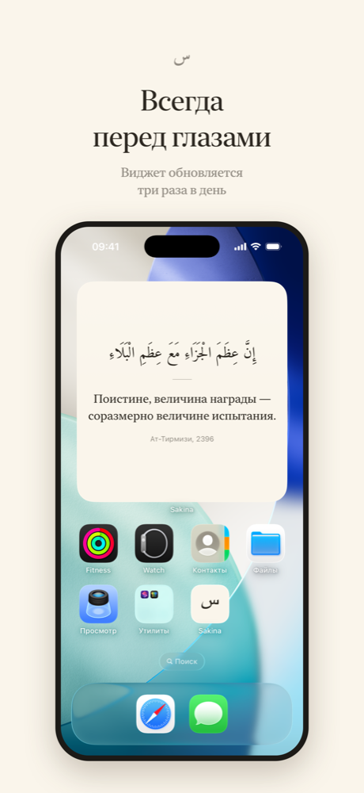
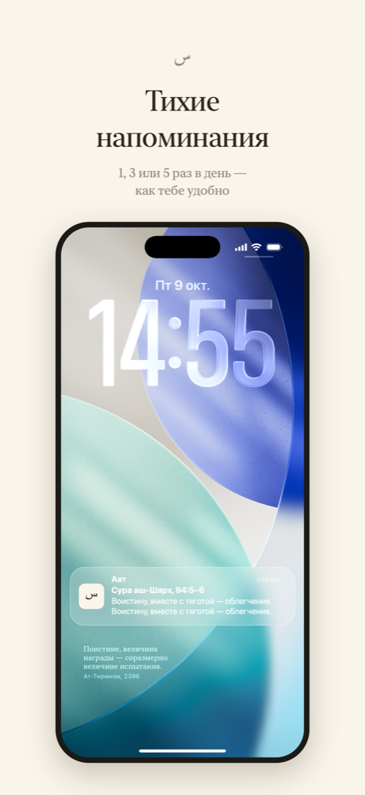

  

<h1 align="center">Sakina — аяты и хадисы</h1>

  iOS-приложение, которое в нужный момент приносит нужные слова — 
  аят из Корана или хадис Пророка (мир ему).

  
  
  

  
  
  
  
  
  

## Возможности

- **Аят или хадис дня** — арабский текст, перевод на русский и источник.
- **«Как ты сейчас?»** — выбери состояние и получи подходящий текст.
- **Источники** — нажатие открывает аят на quran.com, хадис на sunnah.com.
- **Напоминания** — 1, 3 или 5 в день, без сервера и интернета.
- **Виджеты** — для главного экрана и экрана блокировки.
- **Поделиться** — текстом в любой мессенджер или карточкой в галерею.
- Без рекламы, регистрации и сбора данных.

Все хадисы — из сборников аль-Бухари и Муслима. Тексты находятся в [`Shared/Verse.swift`](Shared/Verse.swift).

## Сборка

1. Открыть `Sakina.xcodeproj` в Xcode.
2. В **Signing & Capabilities** выбрать свою команду для целей `Sakina` и `SakinaWidgetExtension`.
3. Запустить на iPhone или симуляторе (iOS 17+).

## Лицензия

Код — [MIT](LICENSE). Шрифты Amiri — [SIL OFL 1.1](Shared/Fonts/OFL.txt).
